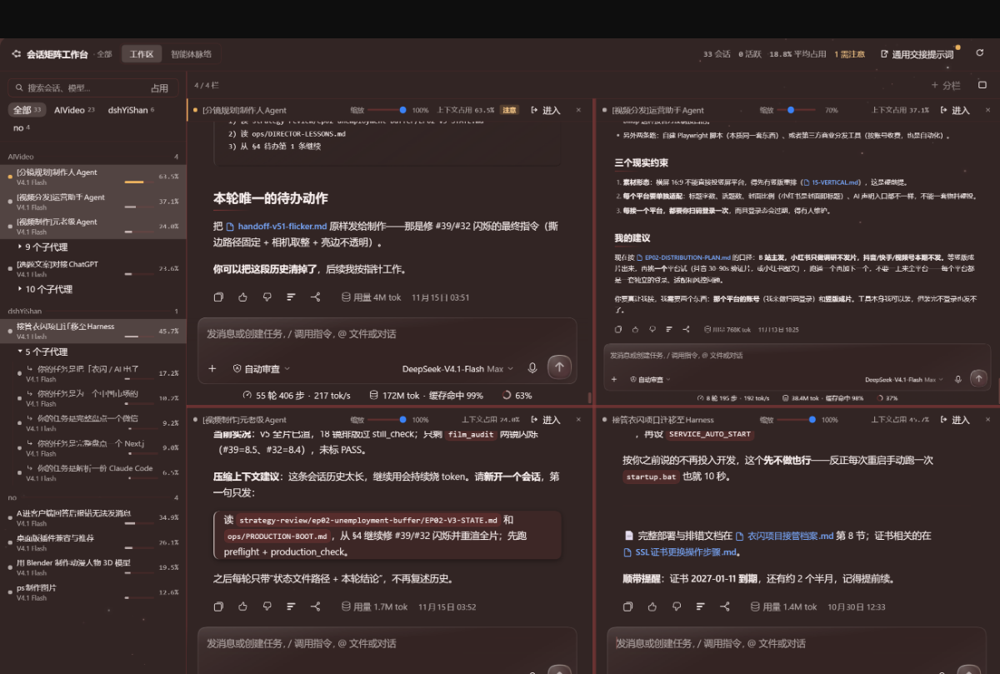
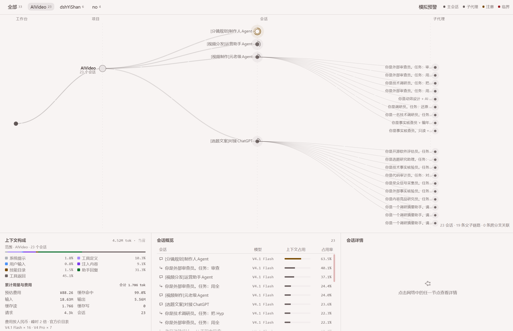

# DSH Session Matrix · 会话矩阵工作台

**给 DeepSeek Harness 的多智能体工作台。** 左侧一个独立入口，进去是两个视图：工作区最多并排四个原生会话窗格；
智能体脉络把「项目 → 主会话 → 子代理」画成一张按压缩风险着色的 Agent Graph。上下文快满之前，
一份交接协议把工作交给下一个会话。

[](https://www.npmjs.com/package/dsh-session-matrix)
[](./LICENSE)
[](https://www.deepseek.com/harness/)

```bash
dsh plugin --profile web add dsh-session-matrix
```


## 入口与视图

装完只多三样东西，没有别的东西插进你的对话流：

| 位置 | 你得到什么 |
|---|---|
| 左侧面板列表 | 一行「会话矩阵工作台」，与「上下文洞察」「技能中心」同级 |
| 面板顶部 | 两个标签：**工作区**、**智能体脉络** |
| 面板右上角 | **通用交接提示词** 按钮，带提醒点，显示有几个会话进入注意区 |

不改 DSH 核心代码，只用公开的 Cordis 服务与 slot 扩展点。

## 工作区：1–4 格原生会话

左侧会话列表按项目分组，子代理折叠在所属主会话下；**归档会话不显示**，与原生侧栏一致，
在原生侧取消归档后下一次刷新即恢复。

右侧窗格按格数排版：

| 格数 | 布局 |
|---|---|
| 1 | 单格铺满 |
| 2 | 左右两列 |
| 3 | 上二下一（下格通栏） |
| 4 | 2×2 |

- 分隔线可拖动，比例写入 `localStorage`（`aw.splitCol` / `aw.splitRow`）。
- 每格标题栏居中一个缩放滑块，55%–100%，按会话记忆。
- 每格挂载的是 DSH 原生 `conversation.content` 工厂实例：消息流、工具调用行、审批、
  Chat/Trajectory 切换、composer 都是原生的，可直接输入。



## 智能体脉络：Agent Graph

四列有向拓扑，从左到右：**工作台 → 项目 → 主会话 → 子代理**。像神经链路一样，每个 Agent 只跟自己的
父级连线。

- 边来自会话头的 `parentSession`，不推断"同项目"这类弱关系。
- 节点颜色表示**距离压缩点的远近**：正常 / 注意 / 临界。
- 节点尺寸关联该会话的累计用量。
- 选中节点后，下图三个模块按该节点的子树重新计算。



### 三个模块

**上下文构成** — 当前 prompt 的九类占比：系统提示、工具定义、用户消息、注入内容、技能加载、
工具调用、思考、回复。标注「当前」，是快照。

**累计用量与费用** — 四个 token 桶相加（未命中 / 缓存读 / 缓存写 / 输出），标注「合计」，
与「当前占用」分开统计，不是同一个量。

**会话矩阵** — 每会话一行：模型、窗口占用、风险级别、轮次。点击进入会话。


## 上下文监控

压缩点由模型窗口和输出预留共同决定，不是固定百分比：

```
compaction point = min(window × 80%, window − max output − 64K headroom)
```

`window × 80%` 留出回复与后续输入的空间；减去输出预留，是因为压缩后仍需生成内容。
1M 窗口、256K 输出的模型，压缩点约 69%，而非 80%。

| 阈值 | 计算 | 含义 |
|---|---|---|
| 注意 | 压缩点 × 80% | 仍可容纳一次较长回复 |
| 临界 | 压缩点 × 92% | 下一次大请求可能触发压缩 |

占用率取**服务端返回的 prompt 大小**（未命中 + 缓存读 + 缓存写），叠加最后一次采样后的增量，
不使用字符数估算。

## 交接协议 v1

按钮生成一段提示词，发进会话后由 Agent 产出结构化交接物：

1. 复制提示词 → 发进目标会话
2. Agent 写出 `HANDOFF-<timestamp>.md`：目标、进度、关键文件、已否决方案、未决问题
3. 回复末尾给出接管消息
4. 新建会话，粘贴接管消息

插件负责复制与定位：目标窗格会闪烁一次，避免粘错会话。


## 费用口径

人民币。DeepSeek 自家模型读官方价目表（元 / 百万 token，谷时）：

| 模型 | 缓存命中 | 缓存未命中 | 输出 |
|---|---|---|---|
| V4.1 Flash（`deepseek-flash`，旧名 `deepseek-v4-flash`） | 0.02 | 1 | 4 |
| V4 Pro（`deepseek-v4-pro`） | 0.15 | 4.5 | 13.5 |

峰时（北京时间工作日 09:00–12:00、14:00–18:00，节假日除外）**×2**。
`contextTimeline.cost` 已按峰谷分桶，直接分桶计算，不做时间推断。
非 `deepseek` provider 回退 models.dev 美元价，按 `1 CNY = 0.15 USD` 折算。

## 与 dsh-context 的关系

`dsh-context` 是这个生态里上下文分析做得最深的插件，也是本项目参考最多的一个：上下文占比怎么读、
费用如何按峰谷折算、面板信息怎么组织，都从它那里学了不少。它的 Fleet 页把当前 Agent 家族画成
Agent Network，我们用同样的父子关系模型，但放在跨项目的全局视图里。

两处刻意对齐：

- **口径一致**：同样的 `1 CNY = 0.15 USD` 与峰时 ×2，两个面板的费用可以对账。
- **职责分开**：逐请求追溯上下文构成、查看某一步装了什么，用它的 Context 标签页与趋势图；
  同时跑多个会话、判断谁该交接，用这里。

两者可同时安装，互不冲突。

## 安装

**插件管理器**：`插件 → 发现`，搜索 `dsh-session-matrix`。

**CLI**：

```bash
dsh plugin --profile web add dsh-session-matrix
dsh plugin --profile web update dsh-session-matrix@latest   # 升级
```

无需构建步骤，无需重启 DSH。浏览器若未刷新，硬刷新一次（`Ctrl/Cmd + Shift + R`）。

**源码**：把仓库路径写入 profile 的 `dependencies`（`link:`）与 `dsh.profile.bundles`，
执行 `pnpm install` 后重启。

## Requirements

| 项 | 值 |
|---|---|
| DeepSeek Harness | `>= 0.2.2-rc.1`（`dsh.compatibility.dshReleases`） |
| Node.js | `^22.19.0` 或 `>= 24` |
| 实测 | DSH `0.2.2-rc.x`，Windows 11 |
| 未实测 | macOS、Linux |
| 运行时依赖 | 无（两个 JS 文件，无构建） |

## Known limitations

- 仅 DeepSeek 模型按人民币计价；其他 provider 走 models.dev 美元价。
- 子代理用量按会话独立统计，不并入父会话（在脉络里选中主会话时，模块按子树汇总）。
- 法定节假日未建模，峰谷桶由宿主提供。
- 归档集合读自 `storages/workspace.json`；DSH 若调整该表的存储结构，需同步修改读取逻辑。
- macOS / Linux 未在真机验证。代码中没有平台分支，但"没写 `if`"不等于"测过"。

## 架构

```
lib/index.js       宿主半边：Cordis 插件，三个 JSON 路由，读投影，价格表
lib/client.js      浏览器半边：React 面板，两个视图，交接弹窗
lib/handoff/v1.md  交接协议，以数据形式发布
test/host.test.mjs 29 个契约测试（不联网，伪造 DSH 上下文）
```

宿主不渲染，客户端不读文件；数据只走三条路由。渲染异常由面板内的错误边界接住，
单个组件出错不会让整个 DSH 窗口空白。

## 开发

```bash
npm test            # 29 个契约测试，不联网
npm pack --dry-run  # 约 10 个文件 / 72 KB
```

无构建步骤；修改 `lib/client.js` 后 DSH 会热重载面板。

## License

[MIT](./LICENSE)

---

## English

**A multi-agent workspace for DeepSeek Harness.** One sidebar entry, two views: up to four native
conversation panes, and an Agent Graph that draws `workbench → project → session → subagent` coloured
by compaction risk. A handoff protocol moves work to a fresh session before compaction drops the details.

```bash
dsh plugin --profile web add dsh-session-matrix
```

**Workspace** — session list grouped by project (subagents folded, archived hidden) plus 1–4 panes.
Layouts: 1 full, 2 columns, 3 as two-over-one, 4 as 2×2. Dividers drag; each pane zooms 55–100%.
Every pane runs DSH's own `conversation.content` factory, so messages, tool rows, approvals, and the
composer are native.

**Agent Graph** — a directed four-column topology. Edges come from `parentSession` in the session
header; node colour is distance to the compaction point; node size tracks cumulative usage. Selecting a
node re-scopes three modules: prompt composition, cumulative usage and cost, and a per-session matrix.

**Context** — compaction point is `min(window × 80%, window − max output − 64K)`; the watch line sits
at 80% of that point, the critical line at 92%. Occupancy uses the provider-reported prompt size, not a
character estimate.

**Handoff** — protocol v1 writes `HANDOFF-<timestamp>.md` (goal, progress, key files, rejected
approaches, open questions) plus a takeover message for the next session; the target pane flashes so
you paste into the right one.

**Cost** — CNY, DeepSeek's official price list, peak hours at 2×; other providers fall back to
models.dev in USD at `1 CNY = 0.15 USD`.

**Requirements** — DSH `>= 0.2.2-rc.1`, Node `^22.19` or `>= 24`, no runtime dependencies. Verified on
Windows 11 with DSH `0.2.2-rc.x`; macOS and Linux are untested.

### Relationship to dsh-context

`dsh-context` is the deeper context-analysis plugin in this ecosystem and the main reference for this
one — its Fleet page draws the current agent family as an Agent Network, and this plugin uses the same
parent-child model across all projects. Both use the same CNY conversion and peak-hour multiplier, so
cost figures reconcile. Install both: use `dsh-context` to trace how a request was assembled, use this
one to run several sessions and decide which to hand off.

### Related work

Split views exist (`dsh-session-grid`, `dsh-multi-session`, `dsh-multi-chat`), as do session-tree maps
(`dsh-session-map`) and handoff helpers (`dsh-context-relay`, `dsh-handoff-kit`). This plugin puts
panes, the graph, and the handoff in one panel; if you need only one of them, those are lighter.
