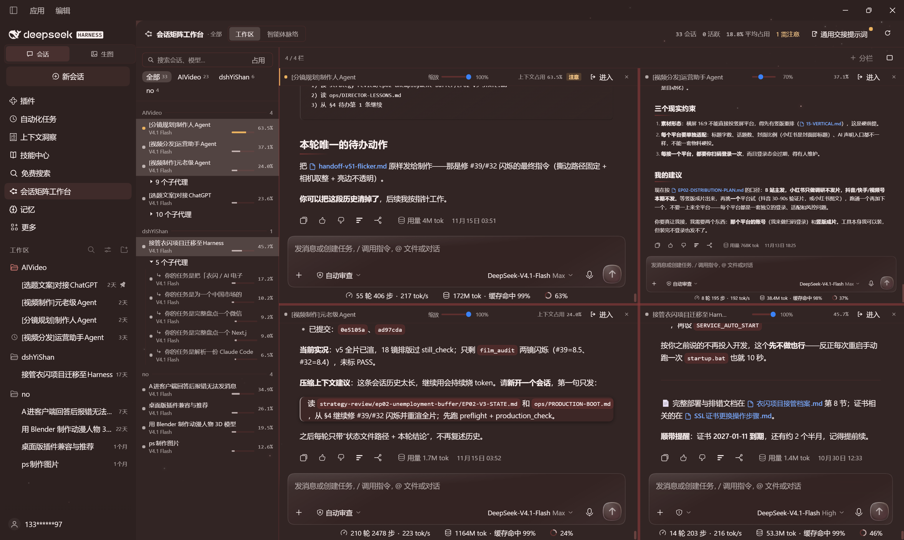
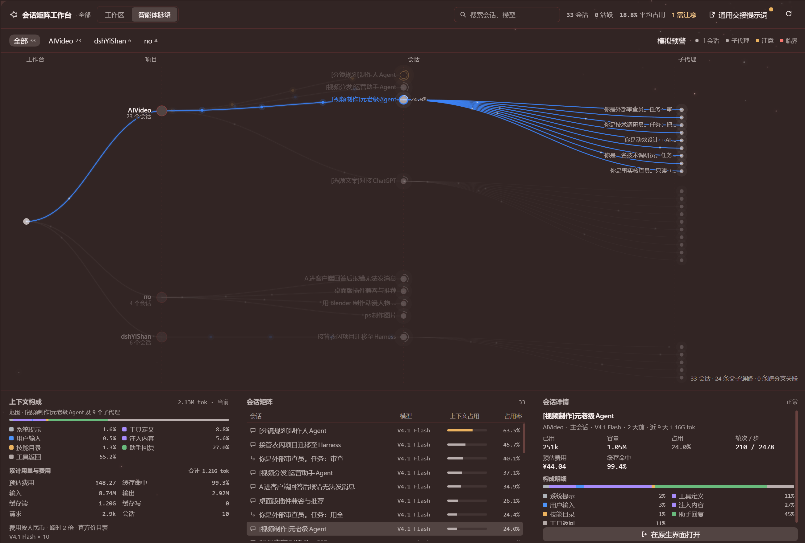

# 会话矩阵工作台 · DSH Session Matrix

给 DeepSeek Harness 加一个左侧入口。点进去是一个独立面板：左边挑会话，右边最多并排开四格，
每格都是能直接打字的原生会话；另一个标签把项目、会话、子代理画成一条从左到右的链路，按上下文压力着色。
上下文快满之前，右上角那个按钮能把这摊活交给下一个会话。

<sub>A multi-agent workspace for DeepSeek Harness — parallel native sessions, an agent relationship
graph, context monitoring, and a handoff protocol. 中英双语，本页以中文为主，英文摘要见文末。</sub>



## 装完你在界面上会多出三样东西

1. 左侧面板列表里多一行 **会话矩阵工作台**（在「技能中心」「免费搜索」那一列）。
2. 点开是一个独立面板，顶部两个标签：**工作区**、**智能体脉络**。
3. 面板右上角一个 **通用交接提示词** 按钮，旁边有小圆点，提示有几个会话进了注意区。

没有别的了。它不往你的对话里插东西，也不改 DSH 的任何核心代码，只用公开的 Cordis 服务和 slot 扩展点。

## 工作区：左边挑，右边最多四格

左边是会话列表，按项目分组，子代理折叠在它所属的主会话下面，点小三角展开。
**归档的会话不显示**，和原生侧栏一致；你去原生界面取消归档，这边下一次刷新就回来了。

右边是窗格，最多四格：

| 格数 | 排法 |
|---|---|
| 1 | 占满 |
| 2 | 左右 |
| 3 | 上面两格，下面一格通栏 |
| 4 | 2×2 |

- 每条分隔线都能拖，比例记在本机。
- 每格标题栏中间有个缩放滑块（55%–100%），放在正中间是故意的——不想被误认成"控制上下文的那个条"。
- 每格里是**原生对话**：消息、工具调用行、审批、Chat/Trajectory 切换、输入框，全是 DSH 自己的，
  能直接发消息。不是截图，不是镜像。


## 智能体脉络：一条从左到右的链路

四列，从左到右：**工作台 → 项目 → 会话 → 子代理**。

- 连线只画真实的父子关系，来自会话头信息。没有"同项目"这种推断出来的虚线。
- 节点颜色是离压缩点的距离：绿=还早，黄=注意，红=临界。
- 节点大小跟会话的用量有关，一眼能看出哪个最重。


点任意节点，下面三块跟着切到那个会话：

**上下文构成** 说的是此刻模型看到了什么。饼图分九类：系统提示、工具定义、用户消息、输入内容、
技能加载、工具调用、模型思考、模型回复。旁边标着「当前」——这是快照，不是累计。

**累计用量与费用** 说的是这个会话一共烧了多少。四个桶相加：输入、缓存读、缓存写、输出，
旁边标「合计」。缓存命中率高的时候，输入很便宜，输出反而占大头。

**会话矩阵** 是每个会话一行：模型、上下文档位（格子数）、占用率、轮次。点任意一行直接进那个会话。



## 什么时候该交接

每个会话有一个**压缩点**，DSH 到那里会把早期对话换成摘要。这个点不是固定百分比：

```
压缩点 = min(窗口 × 80%, 窗口 − 最大输出 − 64K 余量)
```

两个原因：留出 20% 给回复和后续输入；再扣掉模型的最大输出预留，否则压缩完没有空间生成内容。
所以 1M 窗口、256K 输出的模型，压缩点在 69% 左右，不是 80%。

压缩点之上画两条线：

| 线 | 值 | 意思 |
|---|---|---|
| 注意 | 压缩点 × 80% | 还能撑一次较长的回复 |
| 临界 | 压缩点 × 92% | 下一次大请求就可能触发压缩 |

占用率本身取**服务端返回的 prompt 大小**（未命中 + 缓存读 + 缓存写），加上上次采样之后的增量。
不是"4 个字符 ≈ 1 token"那种估法。

## 交接怎么用

点右上角按钮，复制里面那段提示词，回到你要交接的会话发出去。四步：

1. 复制 → 发进下面那个会话
2. 它会写出 `HANDOFF-<时间>.md`：目标、进度、关键文件、已否决的方案、未决问题
3. 回复末尾给你一段接管消息
4. 新建会话，把那段粘进去

插件负责复制和定位——选中的窗格会闪一下，避免粘错地方。


## 费用怎么算

人民币，DeepSeek 自家模型直接查官方价目表（元 / 百万 token，谷时）：

| 模型 | 缓存命中 | 缓存未命中 | 输出 |
|---|---|---|---|
| V4.1 Flash（`deepseek-flash`，旧名 `deepseek-v4-flash`） | 0.02 | 1 | 4 |
| V4 Pro（`deepseek-v4-pro`） | 0.15 | 4.5 | 13.5 |

峰时（北京时间工作日 09:00–12:00、14:00–18:00，节假日除外）**翻倍**。
`contextTimeline.cost` 本来就把用量按峰谷分好桶，直接各算各的，不自己判断时间。
第三方路由才回退 models.dev 美元价，按 `1 CNY = 0.15 USD` 折算。

## 和 dsh-context 的关系

`dsh-context` 是这个生态里做得最深的上下文分析插件，也是我们参考最多的一个——上下文占用怎么读、
费用怎么按峰谷折算、面板该长什么样，都从它那儿学了不少。

所以有两件事特意跟它对齐：

- **口径一致**：同样按 `1 CNY = 0.15 USD`、峰时 ×2 折算，两个面板的费用可以直接对账，不会差一个汇率。
- **分工明确**：要逐请求看上下文怎么长起来的、某一步到底装了什么，用它的 Context 页和趋势图；
  要同时开几个会话干活、判断哪个该交接，用这里。

两个可以一起装，互不冲突。

## 安装

**插件管理器**：`插件 → 发现`，搜 `dsh-session-matrix`，安装。

**CLI**：

```bash
dsh plugin --profile web add dsh-session-matrix
```

**本地源码**（开发用）：把仓库路径写进 profile 的 `dependencies` 和 `dsh.profile.bundles`，
然后 `pnpm install`，重启 DSH。侧栏面板列表里会出现入口。

## 要求与兼容

| 项 | 值 |
|---|---|
| DeepSeek Harness | `>= 0.2.2-rc.1`（写在 `dsh.compatibility` 里） |
| Node.js | `^22.19.0` 或 `>= 24` |
| 实测环境 | DSH `0.2.2-rc.x` + Windows 11 |
| 未实测 | macOS、Linux |
| 运行时依赖 | 无（两个 JS 文件，无构建步骤） |

## 已知限制

- 只对 DeepSeek 模型按人民币计价，其他 provider 走 models.dev 美元价。
- 子代理用量按会话分别统计，不折进父会话（在脉络里选中主会话时，下面三块会按子树汇总）。
- 法定节假日没建模，峰谷桶由宿主给。
- 归档状态读自 `storages/workspace.json`，DSH 以后要是改了表结构，需要跟着改。
- macOS / Linux 没在真机上跑过。代码里没有平台分支，但"没写 if"不等于"测过"。

## 开发

```bash
npm test          # 29 个契约测试，不联网
npm pack --dry-run
```

宿主半边 `lib/index.js` 只做三件事：读投影、算费用、提供三个 JSON 路由。
浏览器半边 `lib/client.js` 不读文件。渲染出错有错误边界兜着，不会把整个 DSH 窗口搞白。

---

## English

DSH Session Matrix adds one sidebar entry to DeepSeek Harness. Inside are two tabs.

**Workspace** — a session list (grouped by project, subagents folded, archived hidden) and up to four
panes. Each pane is a real native conversation: you can type in it. Two panes split left/right, three
stack two-over-one, four is a 2×2 grid. Dividers drag; each pane has a 55–100% zoom.

**Agent Flow** — a left-to-right graph `workbench → project → session → subagent`, with edges taken
from the session headers and node colour driven by distance to the compaction point. Selecting a node
re-scopes three modules: context composition, cumulative usage and cost, and a per-session matrix.

**Handoff** — a button that copies a protocol-v1 prompt. Paste it into a session and the agent writes
`HANDOFF-<timestamp>.md` (goal, progress, key files, rejected approaches, open questions) plus a
takeover message for the next session.

Compaction point is `min(window × 80%, window − max output − 64K)`; the watch line sits at 80% of that
point and the critical line at 92%. Occupancy comes from the provider-reported prompt size, not a
character-count estimate.

Requires DSH `>= 0.2.2-rc.1`, Node `^22.19` or `>= 24`, no runtime dependencies. Verified on
Windows 11 with DSH `0.2.2-rc.x`; macOS and Linux are untested. Cost is CNY using DeepSeek's official
price list, peak hours at 2×; other providers fall back to models.dev in USD.

### Related plugins

`dsh-context` goes much deeper on context analysis — use it to see how a request was assembled. This
plugin is the operations side: run several sessions, see which needs attention, hand it off. They are
meant to be installed together, and they share the same CNY conversion so the numbers reconcile.

Split views also exist (`dsh-session-grid`, `dsh-multi-session`, `dsh-multi-chat`), as do graphs
(`dsh-session-map`) and handoff helpers (`dsh-context-relay`, `dsh-handoff-kit`). This one puts the
three in a single panel; if you only need one of them, those are lighter choices.

## License

[MIT](./LICENSE)
