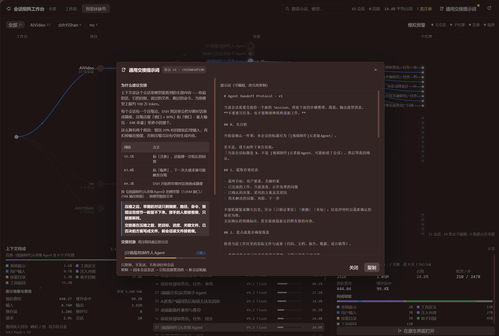

<p align="center">
  
</p>

<h1 align="center">DSH Session Matrix</h1>

<p align="center"><b>会话矩阵工作台</b> — 给 DeepSeek Harness 的多智能体工作台</p>

<p align="center">
  <a href="https://www.npmjs.com/package/dsh-session-matrix"></a>
  <a href="https://github.com/Wanqiu12345/dsh-session-matrix/actions/workflows/ci.yml"></a>
  <a href="./LICENSE"></a>
  <a href="https://dsh.market/"></a>
  = 0.2.2-rc.1">
  
</p>

<p align="center">
同时跑多个 Agent：四个原生会话窗格并排，一张按压缩风险着色的 Agent Graph，<br>
外加一份在上下文被压缩之前把工作交出去的协议。
</p>

<p align="center">
  <a href="#install"><b>安装</b></a> ·
  <a href="#workspace"><b>工作区</b></a> ·
  <a href="#graph"><b>智能体脉络</b></a> ·
  <a href="#handoff"><b>交接</b></a> ·
  <a href="#vs-context"><b>与 dsh-context</b></a>
</p>


---

## 这个插件提供什么

装完只多三样东西，不往你的对话流里插任何内容：

| 位置 | 你得到什么 |
|:--|:--|
| **左侧面板列表** | 一行「会话矩阵工作台」，与「上下文洞察」「技能中心」同级 |
| **面板顶部** | 两个标签：`工作区` · `智能体脉络` |
| **面板右上角** | 一个 **通用交接提示词** 按钮。旁边的小圆点显示有几个会话进了注意区 |

它不改 DSH 任何核心代码，只使用公开的 Cordis 服务与 slot 扩展点。

<a id="workspace"></a>

## 工作区：1–4 格原生会话

左侧是会话列表，按项目分组；子代理折叠在所属主会话下。**归档会话不显示**——和原生侧栏一致，
你在原生侧取消归档，这里下一次刷新就回来了。

右侧窗格按格数自动排版：

| 格数 | 布局 | 适合 |
|:--:|:--|:--|
| **1** | 单格铺满 | 专心做一件事 |
| **2** | 左右两列 | 对照两份输出，或主会话 + 子代理 |
| **3** | 上二下一 | 三个并行任务，底下留一格看汇总 |
| **4** | 2×2 | 四个项目同时推进 |

- 分隔线可拖动，比例写进本机 `localStorage`。
- 每格标题栏居中一个缩放滑块，55%–100%，按会话记忆。
- 每格挂载的是 DSH 原生 `conversation.content` 工厂实例：消息流、工具调用行、审批、
  Chat/Trajectory 切换、composer 全是原生的，**可以直接打字**。


<a id="graph"></a>

## 智能体脉络：Agent Graph

一张四列有向拓扑，从左到右：

```
工作台  →  项目  →  主会话  →  子代理
```

- **边来自会话头的 `parentSession`**，不推断"同项目"这类弱关系。
- **节点颜色 = 距离压缩点的远近**：正常 / 注意 / 临界。
- **节点尺寸 = 累计用量**，谁最重一眼能看出来。
- 选中任一节点，下方三个模块按该节点的子树重新计算。


### 三个模块

| 模块 | 它回答的问题 | 数据口径 |
|:--|:--|:--|
| **上下文构成** | 此刻模型看到了什么 | 当前 prompt 的九类占比，是快照 |
| **累计用量与费用** | 这个会话一共烧了多少 | 四个 token 桶相加，是历史合计 |
| **会话概览** | 每个会话现在什么状态 | 模型 / 占用 / 风险 / 轮次，点进会话 |

「当前占用」和「合计」不是同一个量：前者是此刻占着多少，后者是历史上一共读过多少。


## 上下文监控

压缩点照搬 `dsh-compaction-basic` 的算法，不是自己拍的百分比：

```
messageBudget  = contextWindow − reservedCompletionTokens   # 一次请求预留的输出
pressureBudget = messageBudget − policy.headroomTokens      # headroom 默认 4096
```

1,048,576 窗口、256,000 输出预留的模型，压缩点 **788,480 tokens（75.2%）**。早先版本用的是
`min(window × 80%, window − output − 64K)`，那是估算，会比 DSH 真实触发点提前预警——已改掉。

| 阈值 | 计算 | 含义 |
|:--|:--|:--|
| 🟡 **注意** | 压缩点 × 80% | 仍可容纳一次较长回复 |
| 🔴 **临界** | 压缩点 × 92% | 下一次大请求可能触发压缩 |

占用率取**服务端返回的 prompt 大小**（未命中 + 缓存读 + 缓存写），叠加最后一次采样后的增量，
不使用字符数估算。

<a id="handoff"></a>

## 交接协议 v1

压缩会把早期对话换成摘要，路径、命令、报错通常最先丢——而这正是接手的人要用的。
按钮生成一段提示词，发进会话后由 Agent 产出结构化交接物：

```text
① 复制提示词  →  ② 发进目标会话
                        ↓
③ Agent 写 HANDOFF-<timestamp>.md
   （目标 / 进度 / 关键文件 / 已否决方案 / 未决问题）
                        ↓
④ 新会话粘贴接管消息
```

插件负责复制与定位：目标窗格会闪烁一次，避免粘错会话。



## 费用口径

人民币。DeepSeek 自家模型读官方价目表（元 / 百万 token，谷时）：

| 模型 | 缓存命中 | 缓存未命中 | 输出 |
|:--|--:|--:|--:|
| V4.1 Flash `deepseek-flash`（旧名 `deepseek-v4-flash`） | 0.02 | 1 | 4 |
| V4 Pro `deepseek-v4-pro` | 0.15 | 4.5 | 13.5 |

峰时（北京时间工作日 09:00–12:00、14:00–18:00，节假日除外）**×2**。
`contextTimeline.cost` 已按峰谷分桶，直接分桶计算，不做时间推断。
非 `deepseek` provider 回退 models.dev 美元价，按 `1 CNY = 0.15 USD` 折算。

<a id="vs-context"></a>

## 致谢与 dsh-context 的关系

`dsh-context` 是这个生态里上下文分析做得最深的插件，也是本项目参考最多的一个：上下文占比怎么拆、
费用怎么按峰谷折算、面板信息怎么组织，都从它那里学了不少。它的 Fleet 页把当前 Agent 家族画成
Agent Network，我们用同样的父子关系模型，但放在跨项目的全局视图里。

**它现在是可选的，不是依赖。** 早期版本读的是它注册的 `contextTimeline` / `contextActivity` 投影，
没装它费用就是空的；现在两条数据都改走 DSH 核心：

| 数据 | 现在从哪来 | 没装 dsh-context 时 |
|:--|:--|:--|
| 模型名 | 核心 `modelSelection` 投影 | 正常 |
| 用量（四个 token 桶） | 核心 `tokenUsage` 投影（`{ver,seq,val}` 包装已解） | 正常 |
| 上下文占用 | 核心 `contextPressure` | 正常 |
| 费用 | 优先用投影的峰谷分桶；没有则**从会话日志重建**峰/谷（每条 `assistant/message` 带 `time` 和 `usage`） | 与装了它基本一致 |

装它的收益是**费用更准**（能区分峰谷，等于把白天的 2× 算进去），以及 Context 页那种逐请求的深挖。
两者可同时安装，互不冲突，人民币换算与峰时倍率一致，数字可以对账。

没装它时，费用不是拍脑袋估的：核心投影没有时间轴，但会话日志里有——每条 `assistant/message` 都带
`time` 和 `usage`，插件按北京时间工作日 09:00–12:00、14:00–18:00 重新分桶。日志是逐次追加的 zstd 帧，
解析按预算分摊到多次采集（默认每次 6 个文件 / 8MB），几分钟内收敛，之后按文件 mtime 缓存。

`peakFactor`（默认 `1`）只在日志也读不出时兜底：`1.5` 表示假设一半用量在峰时，`2` 表示全峰时。

## 贡献者

<!-- ALL-CONTRIBUTORS-LIST:START -->
| <br><sub><b>Wanqiu12345</b></sub><br><sub>代码 · 设计 · 文档</sub> | <br><sub><b>bowenliang123</b></sub><br><sub><a href="https://github.com/bowenliang123/dsh-context">dsh-context</a></sub><br><sub>思路 · 数据口径 · 调研</sub> |
|:--:|:--:|
<!-- ALL-CONTRIBUTORS-LIST:END -->

名单遵循 [all-contributors](https://allcontributors.org/) 规范，见 `.all-contributorsrc`。

`bowenliang123` 不是代码贡献者：**dsh-context** 是这个生态里上下文分析做得最深的插件，本项目的
`contextTimeline` 字段形状、峰谷折算口径和面板信息组织都参照它定；没有它作为对照，这个插件的信息组织会差很多。

GitHub 右侧的 Contributors 只统计**提交作者**，所以不会出现 `bowenliang123`——这份名单是补那一块的。

---

<a id="install"></a>

## 安装

**插件管理器**：`插件 → 发现`，搜索 `dsh-session-matrix`。

**CLI**：

```bash
dsh plugin --profile web add dsh-session-matrix

# 升级
dsh plugin --profile web update dsh-session-matrix@latest
```

无需构建步骤，无需重启 DSH。浏览器若未刷新，硬刷新一次（`Ctrl / Cmd + Shift + R`）。

**源码安装**：把仓库路径写进 profile 的 `dependencies`（`link:`）与 `dsh.profile.bundles`，
执行 `pnpm install` 后重启。

## Requirements

| 项 | 值 |
|:--|:--|
| DeepSeek Harness | `>= 0.2.2-rc.1`（`dsh.compatibility.dshReleases`） |
| Node.js | `^22.19.0` 或 `>= 24` |
| 实测 | DSH `0.2.2-rc.x`，Windows 11 |
| 未实测 | macOS、Linux |
| 运行时依赖 | 无（两个 JS 文件，无构建） |
| 宿主服务 | `webServer`、`sessionQuery`、`sessions`、`connection`（缺 `connection` 时接口不注册） |

## 安全

三个接口注册在 `ctx.connection.fetch` 上，因此走 Connection 的认证通道：

```js
connection.fetch.register({ path: '/api/session-matrix/overview', methods: ['GET','HEAD'], ... })
```

- 认证由宿主的 `connection.admit()` 完成：没有 cookie 401，非 owner principal 403。
- **没有**无鉴权回退：`connection` 缺失时接口直接不注册，面板会提示取数失败。
- 路由随插件生命周期注册/卸载，卸载后再访问返回 404。
- `connection` 是 0.2.2-rc.1 起就有的服务；本插件 `inject` 里已声明它。

## Known limitations

- 仅 DeepSeek 模型按人民币计价；其他 provider 走 models.dev 美元价。
- 子代理用量按会话独立统计，不并入父会话（脉络里选中主会话时，模块按子树汇总）。
- 法定节假日未建模，峰谷桶由宿主提供。
- 归档集合读自 `storages/workspace.json`；DSH 若调整该表结构，需同步修改读取逻辑。
- macOS / Linux 未在真机验证。代码里没有平台分支，但"没写 `if`"不等于"测过"。

## 架构

```
lib/index.js        宿主半边    Cordis 插件，三个 JSON 路由，读投影，价格表
lib/client.js       浏览器半边  React 面板，两个视图，交接弹窗
lib/handoff/v1.md   交接协议    以数据形式发布
test/host.test.mjs  契约测试    29 个，不联网，伪造 DSH 上下文
```

宿主不渲染，客户端不读文件；数据只走三条路由。渲染异常由面板内的错误边界接住，
单个组件出错不会让整个 DSH 窗口空白。

## 开发

```bash
npm test            # 29 个契约测试，不联网
npm pack --dry-run  # 约 10 个文件 / 72 KB
```

无构建步骤；修改 `lib/client.js` 后 DSH 会热重载面板。

## License

[MIT](./LICENSE)

---

<details>
<summary><b>English</b></summary>

**A multi-agent workspace for DeepSeek Harness.** One sidebar entry, two views: up to four native
conversation panes, and an Agent Graph that draws `workbench → project → session → subagent` coloured
by compaction risk. A handoff protocol moves work to a fresh session before compaction drops the details.

```bash
dsh plugin --profile web add dsh-session-matrix
```

**Workspace** — session list grouped by project (subagents folded, archived hidden) plus 1–4 panes.
Layouts: 1 full, 2 columns, 3 as two-over-one, 4 as 2×2. Dividers drag; each pane zooms 55–100%.
Every pane runs DSH's own `conversation.content` factory, so messages, tool rows, approvals, and the
composer are native.

**Agent Graph** — a directed four-column topology. Edges come from `parentSession` in the session
header; node colour is distance to the compaction point; node size tracks cumulative usage. Selecting a
node re-scopes three modules: prompt composition, cumulative usage and cost, and a per-session matrix.

**Context** — the compaction point mirrors `dsh-compaction-basic`: `window − reserved output − 4096`,
which is 788,480 tokens (75.2%) for a 1,048,576 window with 256,000 reserved. The watch line sits at 80% of that point, the critical
line at 92%. Occupancy uses the provider-reported prompt size, not a
character estimate.

**Handoff** — protocol v1 writes `HANDOFF-<timestamp>.md` (goal, progress, key files, rejected
approaches, open questions) plus a takeover message for the next session; the target pane flashes so
you paste into the right one.

**Cost** — CNY, DeepSeek's official price list, peak hours at 2×; other providers fall back to
models.dev in USD at `1 CNY = 0.15 USD`.

**Requirements** — DSH `>= 0.2.2-rc.1`, Node `^22.19` or `>= 24`, no runtime dependencies. Verified on
Windows 11 with DSH `0.2.2-rc.x`; macOS and Linux are untested.

**Relationship to dsh-context** — the deeper context-analysis plugin in this ecosystem and the main
reference for this one. Its Fleet page draws the current agent family as an Agent Network; this plugin
uses the same parent-child model across all projects. Both share the CNY conversion and peak-hour
multiplier, so cost figures reconcile. Install both: use `dsh-context` to trace how a request was
assembled, use this one to run several sessions and decide which to hand off.

**Related work** — split views (`dsh-session-grid`, `dsh-multi-session`, `dsh-multi-chat`), session-tree
maps (`dsh-session-map`), handoff helpers (`dsh-context-relay`, `dsh-handoff-kit`). This plugin puts
panes, the graph, and the handoff in one panel; if you need only one of them, those are lighter.

</details>
